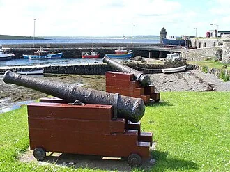

# WikiRNG

[Play WikiRNG](https://wikirng.org/) to find a new corner of English Wikipedia. Answer one quick question each day and turn over a card with an article, a short excerpt, and its rarity.

Each UTC day has one draw. A correct quiz answer opens all five rarity tiers. An incorrect answer still earns Silver or Bronze. Open [Achievements](https://wikirng.org/#journal) to revisit unlocked cards, or browse the [Article Pool](https://wikirng.org/#pool) between draws.

Each revealed card pairs a short article summary with its Wikipedia source. Rarity follows the article’s pageviews in the current edition, so a daily draw can introduce you to a subject few readers have visited.

Balfour Harbour photo by [Colin Smith](https://commons.wikimedia.org/wiki/File:Shapinsay_Harbour_-_geograph.org.uk_-_485300.jpg), [CC BY-SA 2.0](https://creativecommons.org/licenses/by-sa/2.0/).

[How to Play](https://wikirng.org/#guide) · [About WikiRNG](https://wikirng.org/about/) · [Contact](https://wikirng.org/contact/)
